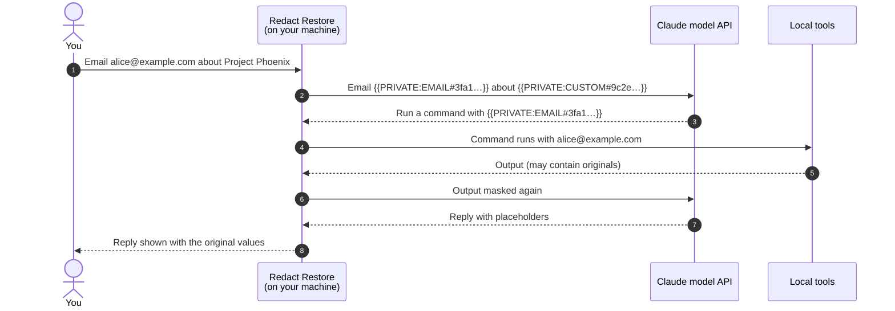
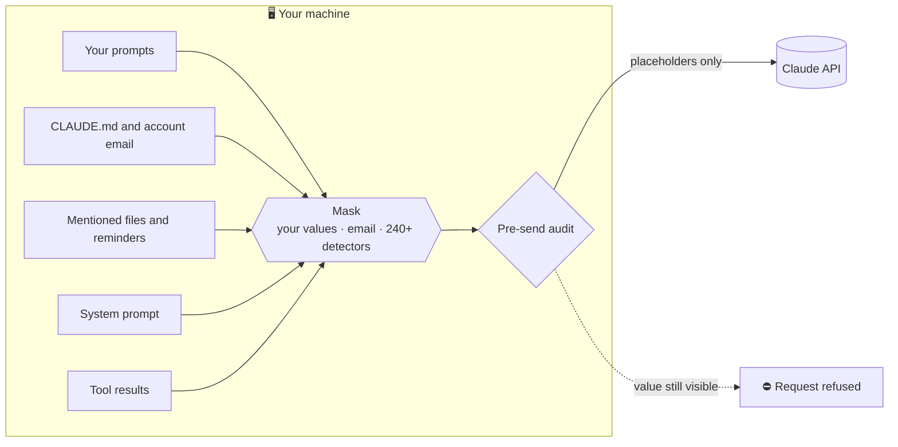
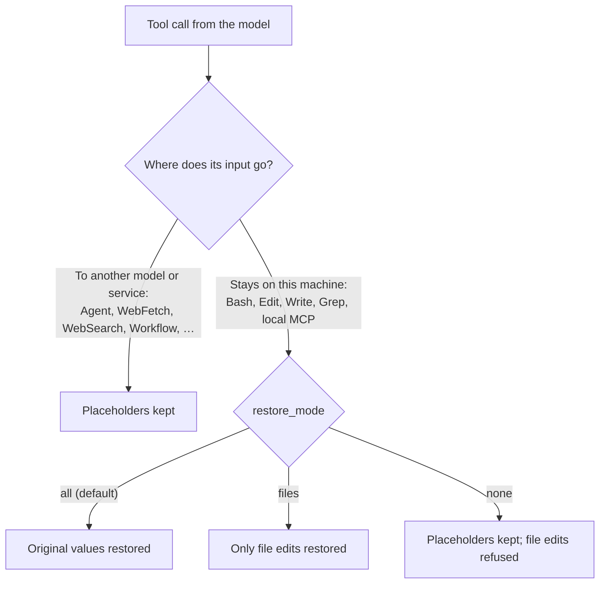

<div align="center">

# 🔐 Redact Restore

**Redacted for the model. Restored for you.**

Use Claude Code on private projects without handing your secrets to the model.<br> Private values become placeholders before they leave your machine, and come back the moment they return.

[](https://github.com/isandrel/redact-restore/actions/workflows/ci.yml) [](LICENSE) [](https://code.claude.com) [](docs/SECURITY.md)

```text
/plugin install redact-restore --marketplace isandrel/redact-restore
```

**[🧪 Try it in 2 minutes with a fake email](#-try-it-in-2-minutes)**

</div>

---

## ✨ Why Redact Restore

Every prompt you type, every file Claude reads and every command output goes to the model. Customer names, internal hostnames, API keys, the email in your git config: all of it is context.

Redact Restore sits **inside** Claude Code as a native Mod:

- 🛡️ **The model sees placeholders**, such as `{{PRIVATE:EMAIL#3fa1c09e8b2d}}`, never the value.
- 🔁 **You see the real thing.** Messages render with the original values on your screen.
- 🧰 **Your tools still work.** `Bash`, `Edit`, `Write`, `Grep` and local MCP tools receive the real values, so builds, scripts and file edits are correct.
- 🔑 **Nothing changes about your login.** Official Claude Pro/Max OAuth, no API gateway, no proxy, no custom base URL.
- 💸 **Free and open source** ([AGPL-3.0](LICENSE)). No account, service or fee of its own: you only need the Claude Code you already use, on whatever Claude plan runs it.

**What it does not do.** It is experimental, not a data-loss-prevention product. It hides only values it knows: your rules plus the [built-in detectors](docs/DETECTORS.md). Images and PDFs are withheld, not scanned. Local tools and other installed mods see real values by design. Details: [security model](docs/SECURITY.md).

## 🧪 Try It in 2 Minutes

No setup and no real data: email detection is on by default, so one fake address shows the whole round trip.

**1. Install** at a Claude Code prompt, then start a new session:

```text
/plugin install redact-restore --marketplace isandrel/redact-restore
```

**2. Send this prompt:**

```text
My test email is alice@example.com. Spell it back one character at a time, then run: echo alice@example.com > redact-test.txt
```

**3. Check the result:**

| Where                                      | You should see                                         | Which proves                            |
| ------------------------------------------ | ------------------------------------------------------ | --------------------------------------- |
| The reply on your screen                   | `alice@example.com`                                    | Placeholders are restored locally       |
| The spelled-out characters                 | `{ { P R I V A T E : E M A I L # …`                    | The model only ever had the placeholder |
| `cat redact-test.txt` in your own terminal | `alice@example.com`                                    | Local tools receive the original        |
| `/redact-restore session`                  | One masked value of kind `EMAIL`, with its placeholder | What was masked this session            |

**4. Tell us what happened.** Share what you saw in each row, and anything masked that should not be, through the [bug report](https://github.com/isandrel/redact-restore/issues/new?template=01-bug-report.yml) or [false positive](https://github.com/isandrel/redact-restore/issues/new?template=04-false-positive.yml) forms. Use fake data only.

## 🧭 How It Works



### Everything that leaves is masked, then audited



### Local tools get real values; model-bound tools never do



## 🚀 Features

| Feature                     | What it does                                                                                                                                                                                                                                                                                           |
| --------------------------- | ------------------------------------------------------------------------------------------------------------------------------------------------------------------------------------------------------------------------------------------------------------------------------------------------------ |
| 🎯 **Your own values**      | List names, codenames, hosts or any exact string. In a form: pick a label (`PROJECT` → `{{PRIVATE:PROJECT#…}}`) or set a fixed alias (`CODENAME_X`).                                                                                                                                                   |
| 🔎 **240+ detectors**       | 200+ API key and token formats (Anthropic, OpenAI, AWS, GitHub, Stripe, Google, …, including the [gitleaks](https://github.com/gitleaks/gitleaks) rule set), JWTs, private keys, passwords, cards, IBANs, and Chinese ID, mobile and company codes, with checksum and entropy validation.              |
| 🧱 **Defense in depth**     | Masks prompts, context, attachments, the system prompt and every stored row; audits each request before it is sent; withholds images it cannot scan.                                                                                                                                                   |
| 🔁 **Reversible by design** | Same value, same placeholder within a session. Restored on screen, optionally while streaming, and in local tool inputs. Unknown placeholders are refused, never guessed.                                                                                                                              |
| ⚙️ **Configurable**          | Placeholder format, which tools get originals, which detectors run, status line content: all options, all with safe defaults.                                                                                                                                                                          |
| 🗂️ **Rules pane and scan**   | `/redact-restore rules` to add, update or remove values; `/redact-restore scan [PATH]` to find your name, coworkers, hosts and settings values locally, on this machine or in any folder; import and export to move them between machines. Values are shown only on your screen, masked until you ask. |
| 📊 **Visible**              | A status line such as `4 private values masked`, a **Session** tab with this session's counts and placeholders, a template, and a status file your own `statusLine` script can read (counts only, never values).                                                                                       |
| 🧪 **Tested**               | Unit and integration suites through the engine's own dispatch, live tests in a real Claude Code session, and a regression test for every reviewed leak.                                                                                                                                                |

## 🆚 Compared With

| Capability                                    | API gateway or proxy | One-way redaction hooks | **Redact Restore** |
| --------------------------------------------- | :------------------: | :---------------------: | :----------------: |
| Keeps the official Claude login and endpoint  |          ❌          |           ✅            |         ✅         |
| Model never sees configured values            |          ✅          |           ✅            |         ✅         |
| Shows you the original values                 |          ✅          |           ❌            |         ✅         |
| Local commands and file edits get real values |          ✅          |         ⚠️ some          |         ✅         |
| Model-bound tools kept on placeholders        |          ➖          |           ➖            |         ✅         |
| Checks every request before it is sent        |       ⚠️ varies       |           ❌            |         ✅         |

## 📦 Quick Start

**1. Install** from [isandrel/redact-restore](https://github.com/isandrel/redact-restore). At a Claude Code prompt, in the terminal or the desktop app's Code tab (answer `y` to add the marketplace, then pick a scope):

```text
/plugin install redact-restore --marketplace isandrel/redact-restore
```

Or from a shell:

```bash
claude plugin marketplace add isandrel/redact-restore
```

```bash
claude plugin install redact-restore@redact-restore
```

**2. Use Claude as usual.** Paste logs, configs or snippets with tokens and secrets: emails, API keys, passwords, private keys, `KEY=value` settings, card, phone and ID numbers are masked before they leave and restored on your screen.

**3. Add what detectors cannot know**, such as names, customers and codenames:

- `/redact-restore scan` finds your git identity, coworkers, remotes, machine and account names, and `.env` values; `/redact-restore scan PATH` checks any folder or file. It runs on your machine, so nothing is sent to the model to judge. Pick **Add** or **Ignore** in the pane.
- `/redact-restore rules` adds your own in a form: the private value (`Acme Corp`), then a label (`CUSTOMER`) or a fixed alias (`CLIENT_A`), with a preview of what the model sees.
- For your most sensitive values, use the keychain instead: `/plugin` → **Installed** → **redact-restore** → **Configure options** → **Exact private values**.

**4. Start clean and check.** Run `/clear`, then `/redact-restore session` or look at the status line under the prompt. Ask Claude to spell a protected value character by character: it can only spell the placeholder.

Update later with `claude plugin update redact-restore@redact-restore`. The plugin also ships skills you can ask for by name: `/redact-restore:protect`, `:scan`, `:status`, `:policy`, `:placeholders`, `:troubleshoot`, `:import` and `:export`.

> Requires Claude Code 2.1.287 or newer with Mods support (the desktop app's Code tab from 2.1.286). A user-scope install is active in every CLI and Desktop Code session; `--scope local` limits it to one folder.

## 📚 Documentation

| Document                               | What it covers                                                          |
| -------------------------------------- | ----------------------------------------------------------------------- |
| [Configuration](docs/CONFIGURATION.md) | Every option, placeholder formats, labels and aliases, status fields    |
| [Detectors](docs/DETECTORS.md)         | What is detected, how it is validated, how to turn detectors on or off  |
| [Security model](docs/SECURITY.md)     | Coverage of every path to the model, review findings, known limitations |
| [Compatibility](docs/COMPATIBILITY.md) | CLI and Desktop Code test matrix                                        |
| [Test plan](docs/TEST_PLAN.md)         | Automated and live test steps                                           |
| [Changelog](CHANGELOG.md)              | Release notes                                                           |

## ⚠️ Status

Redact Restore is **experimental**. It is tested live in the Claude Code CLI 2.1.287 (including subagents, compaction, `/resume` and concurrent sessions); In the desktop app's Code tab the status line is confirmed; the rest is kit-tested only so far. It is not a data-loss-prevention product: it protects the paths described in the [security model](docs/SECURITY.md), and tools that run locally act on real values by design. Try it with synthetic data first.

## 🤝 Contributing

Contributions are welcome: new detectors, false-positive fixes, docs and tests. Read the [contributing guide](CONTRIBUTING.md), and report leaks privately through [SECURITY.md](SECURITY.md), never in a public issue. This project follows a [Code of Conduct](CODE_OF_CONDUCT.md).

## 🌐 Community

Thanks to [LINUX DO](https://linux.do/) for supporting open-source developers and community sharing.

## 📄 License

[GNU Affero General Public License v3.0](LICENSE). The vendored gitleaks rules in `hooks/vendor/` are MIT-licensed; see [hooks/vendor/LICENSE-gitleaks.txt](hooks/vendor/LICENSE-gitleaks.txt).
